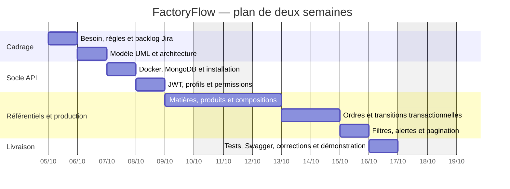
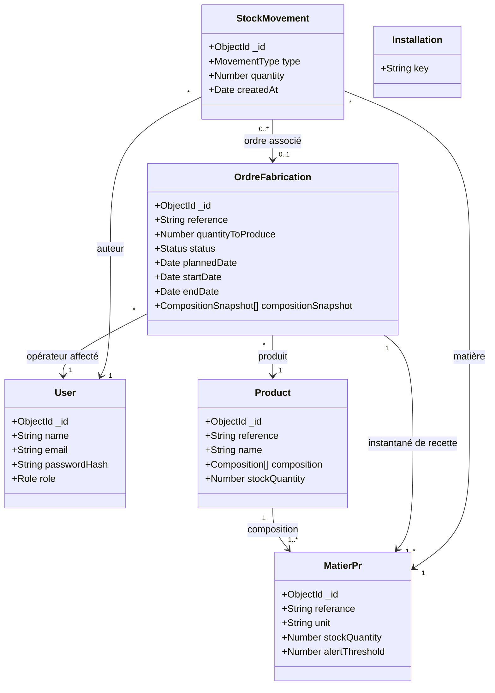

# Planification et conception FactoryFlow

## Gantt (période du brief : 5 au 16 octobre 2026)

Les dépendances sont séquentielles sur le chemin principal : les ordres dépendent des utilisateurs, matières et produits ; les tests et la démonstration viennent après les parcours métier. Le suivi Jira reste à reporter dans l’espace Jira de l’apprenant.

## UML — modèle de domaine

